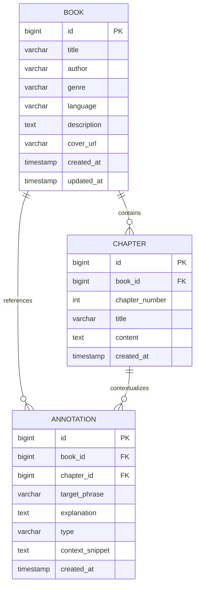
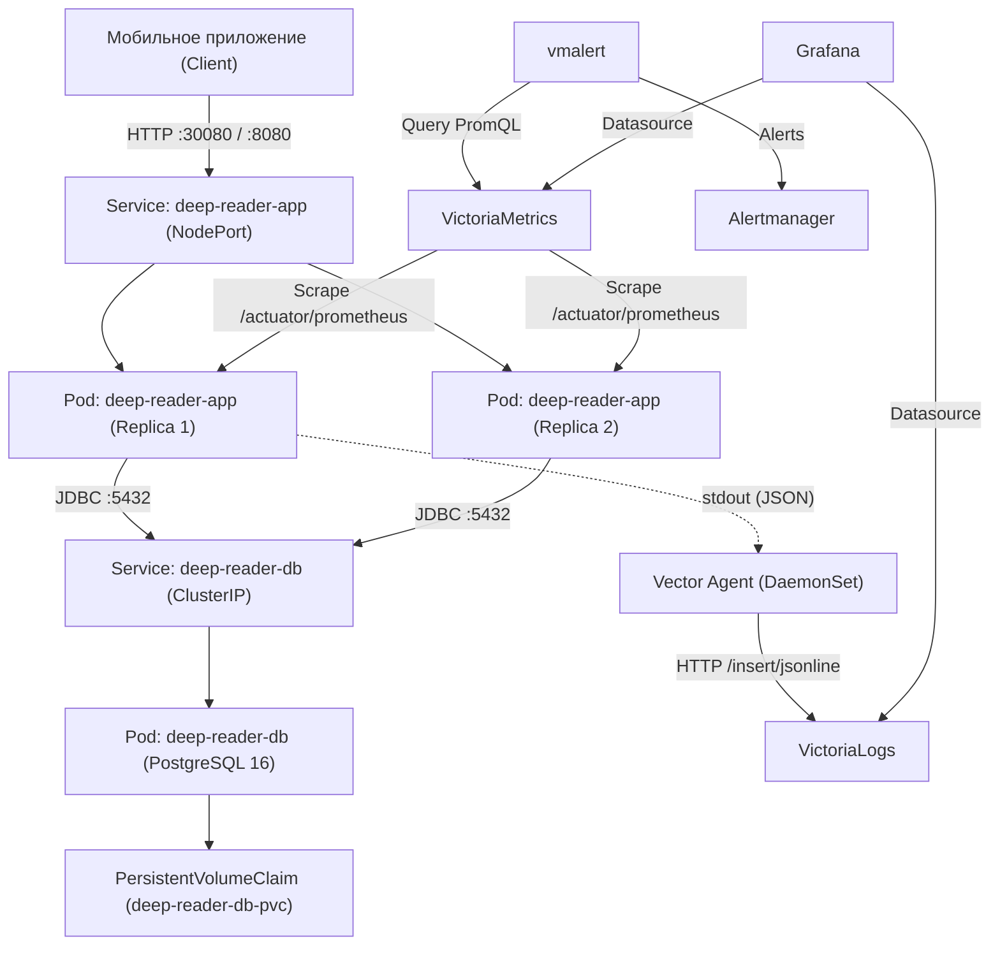

# Архитектура и эксплуатационная документация: Deep Reader Backend & Observability Platform

## 1. Назначение и концепция проекта

**Deep Reader Backend** — высокопроизводительный Cloud-Native бэкенд-сервис, спроектированный как API-ядро для мобильного приложения осознанного чтения художественной литературы в оригинале.

Сервис решает фундаментальную проблему механического словарного перевода классических и современных текстов: мобильный клиент запрашивает структурированные тексты произведений и предоставляет читателю интерактивные контекстные сноски, объяснения сленга, авторских метафор, идиом, исторических аллюзий и подтекста.

### Ключевой стек технологий:
- **Язык и runtime:** Java 25, **Spring Boot 4.1.1** (Spring Data JPA, Hibernate 7, Spring Web, Validation, Actuator).
- **СУБД:** **PostgreSQL 16** с оптимизированным пулом соединений HikariCP.
- **Миграции БД:** **Liquibase** (декларативное версионирование схемы через YAML/SQL).
- **Контейнеризация и оркестрация:** Multi-stage Docker, Docker Compose, Kubernetes (Minikube / Production K8s через Kustomize).
- **Сбор и централизация логов:** Logback Custom JSON Layout (MDC, `trace_id`, `span_id`), **Vector DaemonSet**, **VictoriaLogs**.
- **Сбор метрик и мониторинг:** Micrometer, **VictoriaMetrics Single**, **Grafana** (RED-метрики, SLA/SLI, JVM, HikariCP, PostgreSQL Exporter).
- **Система алертинга:** **vmalert**, **Alertmanager**.

---

## 2. Доменная модель и архитектура данных

В основе сервиса лежит реляционная доменная модель, обеспечивающая целостность данных и быстродействие при операциях чтения и поиска:



### Основные сущности:
1. **`Book` (Книга):** Метаданные литературного произведения (название, автор, жанр, язык оригинала, аннотация, обложка). Имеет каскадные связи `@OneToMany` с главами и сносками.
2. **`Chapter` (Глава):** Порядковый номер, название и полный текст главы. Связана с родительской книгой через внешний ключ `book_id`.
3. **`Annotation` (Контекстная сноска):** Фрагмент оригинального текста (`target_phrase`), разбор подтекста (`explanation`), тип комментария (`AnnotationType`: `SLANG`, `METAPHOR`, `ALLUSION`, `HISTORICAL_CONTEXT`, `LINGUISTIC_NOTE`, `THEMATIC_ANALYSIS`, `CULTURAL_REFERENCE`) и окружающий контекст (`context_snippet`).

Миграции схемы БД автоматизированы через **Liquibase** (`src/main/resources/db/changelog/`).

---

## 3. Методология 12 факторов (The Twelve-Factor App)

Сервис полностью соответствует стандартам 12-факторной разработки:

| № | Фактор | Реализация в Deep Reader Backend |
|---|---|---|
| **I** | **Кодовая база (Codebase)** | Единый Git-репозиторий отслеживает весь проект. Сборка единого неизменяемого артефакта (Docker-образа), развертываемого в любые среды (dev, staging, k8s). |
| **II** | **Зависимости (Dependencies)** | Явная декларация зависимостей в `pom.xml`, фиксация версии с использованием Maven Wrapper (`mvnw`). |
| **III** | **Конфигурация (Config)** | Строгое разделение кода и настроек. Все параметры вынесены в переменные окружения (`SPRING_DATASOURCE_URL`, `DB_POOL_MAX`, `PORT`, `LOG_LEVEL`). Локально используется `.env`, в Kubernetes — `ConfigMap` и `Secret`. |
| **IV** | **Сторонние службы (Backing services)** | PostgreSQL трактуется как подключаемый ресурс через JDBC URL. Подключение локальной базы или облачного кластера не требует правок в коде. |
| **V** | **Сборка, релиз, выполнение (Build, release, run)** | Четкое разделение этапов: компиляция кода и прогон тестов (`mvn package`), упаковка в Docker-образ с тегом, поставка в кластер с версионированными манифестами. |
| **VI** | **Процессы (Processes)** | Приложение полностью **Stateless**. Вся информация сохраняется в СУБД. Реплики сервиса могут свободно создаваться и уничтожаться без риска потери данных. |
| **VII** | **Привязка портов (Port binding)** | Сервис полностью автономен, включает встроенный сервер Apache Tomcat и слушает TCP-порт, переданный в переменной `${PORT:8080}`. |
| **VIII** | **Параллелизм (Concurrency)** | Горизонтальное масштабирование репликами подов в Kubernetes (`kubectl scale deployment deep-reader-app --replicas=N`). |
| **IX** | **Утилизируемость (Disposability)** | Быстрый запуск и безопасный **Graceful Shutdown** (`server.shutdown: graceful`, таймаут `20s`) для корректного завершения активных клиентских HTTP-запросов. |
| **X** | **Паритет окружений (Dev/prod parity)** | Одинаковая СУБД PostgreSQL 16 и идентичный контейнерный стек на всех этапах жизненного цикла. |
| **XI** | **Журналирование (Logs)** | Приложение пишет поток событий в `stdout` в структурированном формате **JSON** (`CustomJsonLayout` с полями MDC: `trace_id`, `span_id`, URI, latency, error). |
| **XII** | **Процессы администрирования (Admin processes)** | Миграции БД на старте через Liquibase; демо-данные наполняются через `DataInitializerService`. |

---

## 4. Контейнеризация и оркестрация в Kubernetes

Архитектура развертывания спроектирована с использованием декларативных спецификаций **Kustomize**:



### Абстракции Kubernetes:
- **`Namespace` (`00-namespace.yaml`):** Изолированное пространство `deep-reader`.
- **`Deployment` бэкенда (`06-app-deployment.yaml`):** Стратегия `RollingUpdate` с `maxSurge: 1` и `maxUnavailable: 0`, Liveness и Readiness пробы по эндпоинту `/api/health`, ресурсные лимиты (CPU: 250m-1000m, RAM: 512Mi-1024Mi).
- **`Deployment` базы данных (`04-postgres-deployment.yaml`):** Стратегия `Recreate` во избежание конфликтов блочного тома при перезапуске.
- **`PersistentVolumeClaim` (`03-postgres-pvc.yaml`):** Персистентное хранилище тома PostgreSQL объемом 1Gi с режимом `ReadWriteOnce`.
- **`ConfigMap` & `Secret` (`01-configmap.yaml`, `02-secret.yaml`):** Разделение конфигурации и чувствительных данных (пароли, учетные записи БД).
- **`Services`:** `ClusterIP` для базы данных и внутренней маршрутизации, `NodePort` (30080) для доступа мобильных клиентов из внешней сети.

---

## 5. Централизованное логирование (Vector & VictoriaLogs)

Для обеспечения прозрачности работы бэкенда и быстрого расследования инцидентов реализована безагентная модель для кода приложения:

1. **Форматирование логов:**
   Класс `CustomJsonLayout` форматирует логи Logback в валидный JSON-объект, содержащий:
   - `timestamp`: ISO-8601 отметка времени;
   - `level`: `INFO`, `WARN`, `ERROR`, `DEBUG`;
   - `logger`: класс-источник события;
   - `message`: текст сообщения;
   - `trace_id`, `span_id`: идентификаторы сквозной трассировки (генерируются `TraceContextFilter` из HTTP-заголовка `X-Trace-Id` или создаются автоматически через UUID);
   - `context`: HTTP-метод, URI, статус ответа, задержка выполнения запроса в миллисекундах.

2. **Сборщик логов (Vector DaemonSet):**
   Развернут на узлах кластера (`k8s/09-vector.yaml`). Читает файлы логов контейнеров `/var/log/pods/deep-reader_*`, парсит CRI-формат, извлекает JSON из поля сообщения и выполняет структурированную доставку по HTTP в **VictoriaLogs**.

3. **Хранилище VictoriaLogs (`k8s/08-victoria-logs.yaml`):**
   Высокопроизводительное хранилище логов с низким потреблением оперативной памяти и поддержкой диалекта запросов **LogsQL**:
   - Поиск критических ошибок: `level:ERROR AND service:deep-reader-backend`
   - Анализ медленных запросов: `uri:/api/annotations AND latency_ms:>300`
   - Трассировка конкретного запроса по ID: `trace_id:3fa85f64-5717-4562-b3fc-2c963f66afa6`

---

## 6. Мониторинг, RED-метрики и Grafana

Сервис собирает и экспортирует метрики через Spring Boot Actuator и библиотеку **Micrometer**:

### Ключевые группы метрик:
1. **RED-метрики (Rate, Errors, Duration):**
   - **Rate:** интенсивность запросов (`http_server_requests_seconds_count`);
   - **Errors:** число и процент пятисотых ответов (`status=~"5.."`);
   - **Duration:** перцентили задержки обработки запросов (p50, p95, p99) и среднее время ответа.
2. **Бизнес-метрики:**
   - Таймер создания аннотаций: `deepreader_annotation_create_duration_seconds` (время парсинга текста и сохранения в PostgreSQL).
3. **Системные метрики JVM:**
   - Память Heap (`jvm_memory_used_bytes{area="heap"}`) и Non-Heap;
   - Нагрузка на сборщик мусора GC (`jvm_gc_pause_seconds`);
   - Потоки JVM (`jvm_threads_live_threads`).
4. **Метрики пула соединений HikariCP:**
   - Активные и ожидающие соединения: `hikaricp_connections_active`, `hikaricp_connections_pending`, `hikaricp_connections_idle`.
5. **Метрики PostgreSQL (PostgreSQL Exporter):**
   - Размер базы данных, число активных клиентских сессий, количество транзакций и блокировок.

### Дашборд Grafana (`grafana-dashboard.json`):
- **Секция SLA & Availability:** Расчет SLA доступности API на 5-минутном окне (`(1 - (errors_5xx / total_requests)) * 100%`) и текущий SLI доступности сервиса.
- **Секция Application Performance (RED):** RPS по эндпоинтам и HTTP-методам, доля ошибок 5xx, средняя и p95 задержка API.
- **Секция Runtime and System Resources:** Заполнение Heap памяти (Gauge с цветовыми порогами), утилизация CPU, профиль потоков, детальная разбивка памяти (Metaspace, Eden, Survivor, Old Gen) и утилизация пула соединений БД HikariCP.

---

## 7. Система правил алертинга (vmalert & Alertmanager)

Алертинг построен на базе связки **vmalert** (`k8s/11-vmalert.yaml`) и **Alertmanager** (`k8s/13-alertmanager.yaml`). Правила алертинга разделены на два уровня (`k8s/14-alerting-rules.yaml`):

### 1. Бизнес-уровень (Business Tier)
- **`DeepReaderHigh5xxErrorRate` (Severity: Critical):**
  - **Условие:** Доля ответов 5xx превышает 1% от общего трафика за 1 минуту (с удержанием 10 секунд).
  - **Значение:** Критическая деградация сервиса — мобильные клиенты получают ошибки при открытии книг или создании заметок.
- **`DeepReaderHighApiLatency` (Severity: Warning):**
  - **Условие:** Среднее время ответа API превышает 300 мс за 1 минуту.
  - **Значение:** Замедление отзывчивости приложения для пользователей.
- **`DeepReaderHighAnnotationLatency` (Severity: Warning):**
  - **Условие:** Время создания контекстной аннотации превышает 300 мс.
  - **Значение:** Проблема с записью в базу данных или блокировками таблиц.

### 2. Системный уровень (Runtime Tier)
- **`JvmMemoryHeapHigh` (Severity: Critical):**
  - **Условие:** Заполнение JVM Heap памяти превышает 80%.
  - **Значение:** Риск падения пода по причине `OutOfMemoryError`.
- **`JvmMemoryHeapWarning` (Severity: Warning):**
  - **Условие:** Заполнение JVM Heap памяти превышает 25%.
  - **Значение:** Предупреждение о росте потребления памяти под нагрузкой.
- **`HikariCPConnectionPoolExhaustion` (Severity: Critical):**
  - **Условие:** Пул соединений HikariCP к PostgreSQL заполнен более чем на 80%.
  - **Значение:** Угроза исчерпания свободных соединений и зависания клиентских запросов.

---

## 8. Спецификация REST API для мобильного клиента

### Книги (`/api/books`)
- `GET /api/books?search={query}`
  - Возвращает каталог книг с количеством доступных глав и аннотаций.
- `GET /api/books/{id}`
  - Возвращает детальные сведения о выбранной книге.
- `POST /api/books`
  - Создает новую запись книги. Принимает JSON: `{ "title": "...", "author": "...", "genre": "...", "language": "...", "description": "..." }`.
- `PUT /api/books/{id}`
  - Обновляет метаданные книги.
- `DELETE /api/books/{id}`
  - Удаляет книгу со всеми связанными главами и аннотациями (каскадное удаление).

### Главы (`/api/chapters`, `/api/books/{bookId}/chapters`)
- `GET /api/books/{bookId}/chapters`
  - Возвращает оглавление книги (список глав с номерами и названиями).
- `GET /api/chapters/{id}`
  - Возвращает полный текст главы для рендеринга на экране мобильного устройства.
- `POST /api/books/{bookId}/chapters`
  - Добавляет новую главу к книге.
- `PUT /api/chapters/{id}`
  - Редактирует текст или заголовок главы.
- `DELETE /api/chapters/{id}`
  - Удаляет главу.

### Контекстные аннотации (`/api/annotations`)
- `GET /api/books/{bookId}/annotations`
  - Возвращает все сноски и комментарии, привязанные к конкретной книге.
- `GET /api/chapters/{chapterId}/annotations`
  - Возвращает сноски к выбранной главе (используется для подсветки сленга и метафор в тексте).
- `POST /api/books/{bookId}/annotations`
  - Создает новую сноску. Принимает:
    ```json
    {
      "chapterId": 1,
      "targetPhrase": "clocks were striking thirteen",
      "explanation": "Сюрреалистическая метафора искаженной реальности тоталитарного государства.",
      "type": "METAPHOR",
      "contextSnippet": "It was a bright cold day in April, and the clocks were striking thirteen."
    }
    ```
- `PUT /api/annotations/{id}`
  - Обновляет текст комментария или тип сноски.
- `DELETE /api/annotations/{id}`
  - Удаляет аннотацию.

### Системные эндпоинты
- `GET /api/health`
  - Возвращает `{ "status": "UP", "service": "deep-reader-backend", "database": "CONNECTED" }`.
- `GET /api/stats`
  - Возвращает аналитические счетчики: `{ "totalBooks": 5, "totalChapters": 24, "totalAnnotations": 87 }`.
- `GET /actuator/prometheus`
  - Эндпоинт сбора метрик для VictoriaMetrics.
