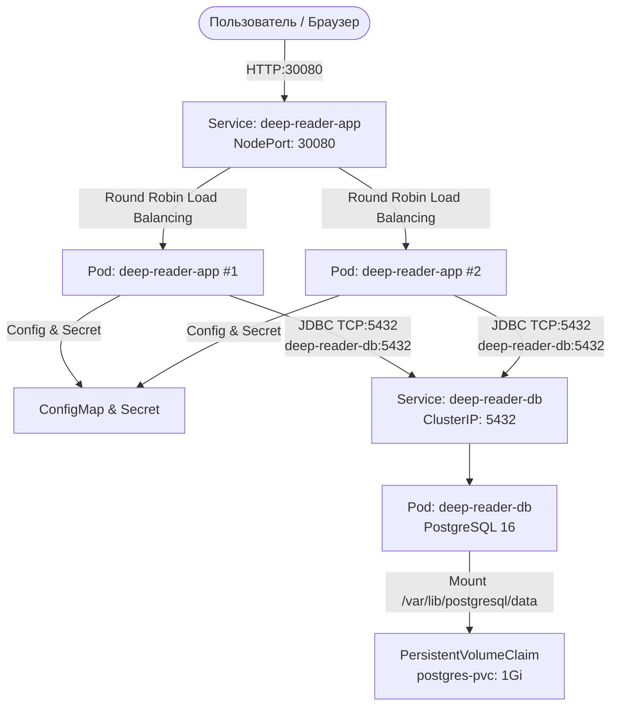

# Отчёт по домашнему заданию: Развёртывание приложения Deep Reader в Kubernetes (Minikube)

---

## 1. Доменная область приложения

**Deep Reader** — веб-приложение для осознанного чтения прозы на языке оригинала с контекстными аннотациями и литературоведческими сносками.

- **Бэкенд:** Java 25, Spring Boot 4.1.1 
- **СУБД:** PostgreSQL 16
- **Фронтенд:** Встроенный HTML5/CSS3/JavaScript UI, раздаваемый Spring Boot

---

## 2. Абстракции Kubernetes, использованные для запуска

Для развёртывания приложения в одноузловом кластере **Minikube** были использованы следующие ключевые абстракции Kubernetes:

### 1. `Pod` (Под)
- Базовая наименьшая единица развертывания в Kubernetes. В кластере создаются и исполняются контейнерные поды: под базы данных (PostgreSQL 16) и под(ы) бэкенда (Spring Boot).

### 2. `Deployment` (Развёртывание)
- **`deep-reader-app`**: Отвечает за жизненный цикл подов Spring Boot приложения. Использует собранный Docker-образ `deep-reader-app:latest` (`imagePullPolicy: IfNotPresent`). Задана стратегия обновления `RollingUpdate` (`maxSurge: 1`, `maxUnavailable: 1`). Задан начальный размер реплик `replicas: 1` с возможностью горизонтального масштабирования через `kubectl scale`.
- **`deep-reader-db`**: Управляет подом базы данных PostgreSQL (`postgres:16-alpine`). Использует стратегию `RollingUpdate` и поддерживает ровно `replicas: 1` (масштабирование СУБД ограничено типом тома `ReadWriteOnce`).

### 3. `Service` (Сетевые сервисы)
- **`deep-reader-app` (тип `NodePort`)**: Открывает доступ к веб-интерфейсу и REST API приложения из внешней сети хост-машины через порт узла `30080` (`http://localhost:30080` или `http://<minikube-ip>:30080`).
- **`deep-reader-db` (тип `ClusterIP`)**: Предоставляет стабильный внутренний IP-адрес и DNS-имя внутри кластера (`deep-reader-db:5432`). Внешний доступ к БД заблокирован ради безопасности.

### 4. `ConfigMap` (`deep-reader-config`)
Содержит неконфиденциальные параметры конфигурации приложения и базы данных:
- `PORT`: `"8080"`
- `DB_NAME`: `"deep_reader"`
- `DB_USERNAME`: `"deep_user"`
- `DB_HOST`: `"deep-reader-db"`
- `DB_PORT`: `"5432"`
- `SPRING_DATASOURCE_URL`: `"jdbc:postgresql://deep-reader-db:5432/deep_reader"`
- `SPRING_DATASOURCE_USERNAME`: `"deep_user"`
- `DB_POOL_MAX`: `"10"`, `DB_POOL_MIN`: `"2"`
- `LOG_LEVEL`: `"INFO"`, `SHOW_SQL`: `"false"`

### 5. `Secret` (`deep-reader-secret`)
Сохраняет конфиденциальные данные (пароли) в изолированном виде:
- `DB_PASSWORD`, `SPRING_DATASOURCE_PASSWORD`, `POSTGRES_PASSWORD`: `"password"`

### 6. `PersistentVolumeClaim` (`postgres-pvc`)
Запрашивает у Kubernetes постоянный объем памяти (1 Гигабайт) с режимом доступа `ReadWriteOnce` для монтирования в директорию `/var/lib/postgresql/data` пода `deep-reader-db`. Гарантирует сохранность данных при перезапуске или пересоздании подов базы данных.

### 7. `Kustomization` (`kustomize.config.k8s.io/v1beta1`)
Абстракция декларирования и управления группой манифестов для их единовременного развертывания через `kubectl apply -k k8s/`.

---

## 3. Взаимодействие сервисов приложения между собой

### Детали взаимодействия:

1. **Маршрутизация внешнего трафика:**
   Запрос пользователя отправляется на NodePort `30080` сервиса `deep-reader-app`. Kube-proxy балансирует трафик между доступными подами бэкенда (`deep-reader-app`).

2. **Внутренняя связь Бэкенд ↔ СУБД:**
   При старте приложение `deep-reader-app` считывает переменную `SPRING_DATASOURCE_URL` со значением `jdbc:postgresql://deep-reader-db:5432/deep_reader`.
   Встроенный в Kubernetes **CoreDNS** автоматически резолвит имя `deep-reader-db` в ClusterIP соответствующего сервиса базы данных.

3. **Инициализация и миграции:**
   Первый поднявшийся под `deep-reader-app` производит подключение к PostgreSQL и автоматически запускает миграции **Liquibase** (`db.changelog-master.yaml`), создавая таблицы и наполняя их демонстрационными данными (`DataInitializerService`).

4. **Пробы готовности и жизнеспособности:**
   - У базы данных настроены `readinessProbe` и `livenessProbe` через утилиту `pg_isready`.
   - У бэкенда настроены `tcpSocket` пробы на порт `8080`.

5. **Особенности масштабирования:**
   Масштабирование бэкенда `deep-reader-app` вызовами `kubectl scale deployment deep-reader-app --replicas=3` увеличивает число подов приложения. СУБД `deep-reader-db` остается в 1 реплике из-за ограничения тома `ReadWriteOnce` (RWO), предотвращая конфликты блокировок данных.
