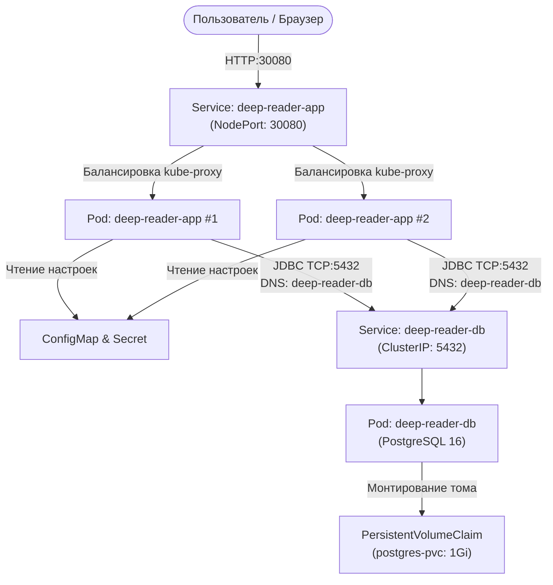
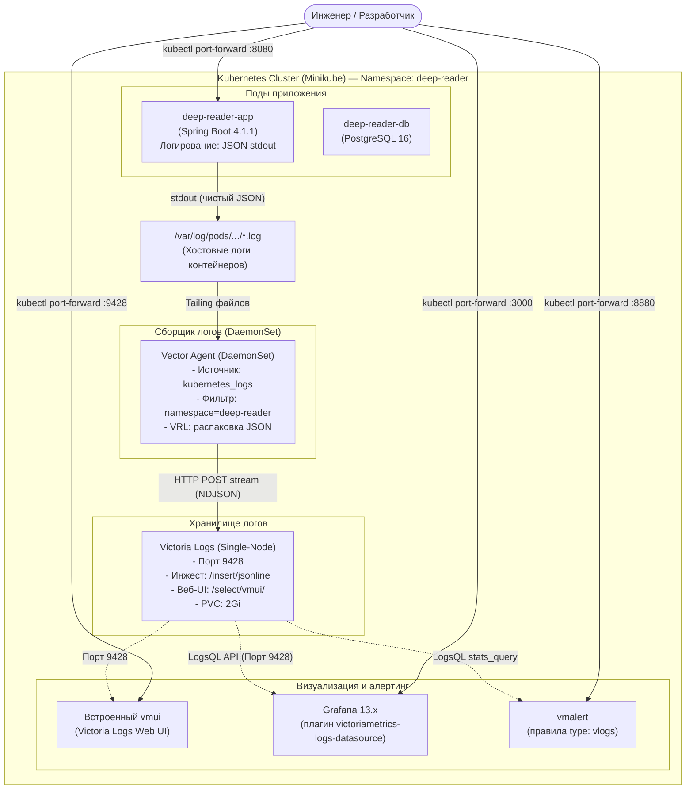
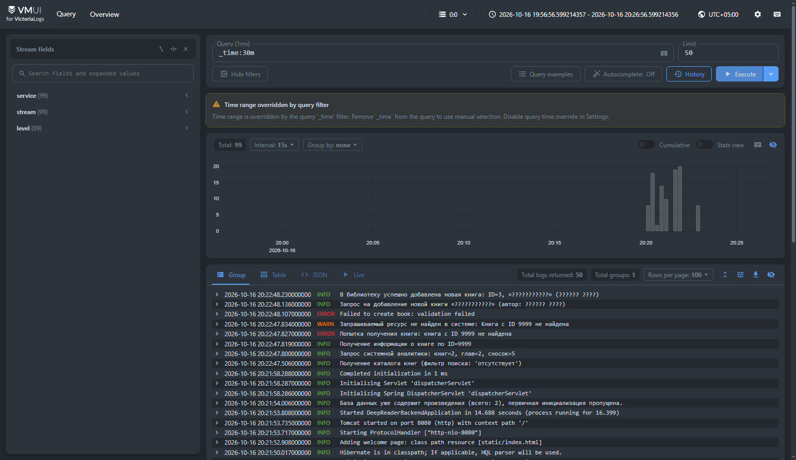
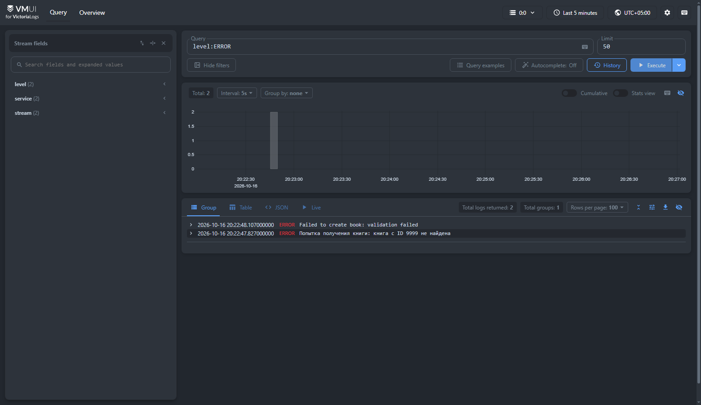
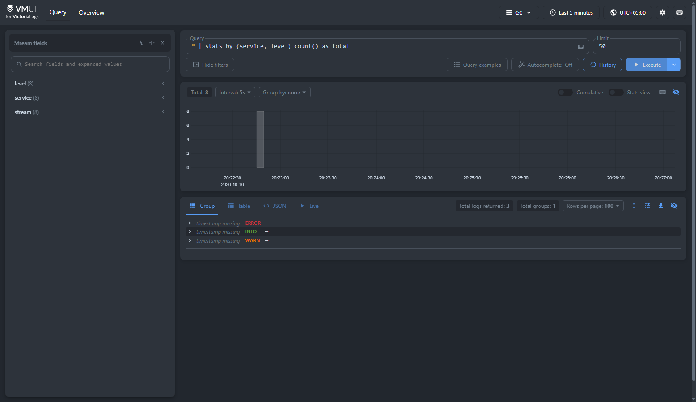
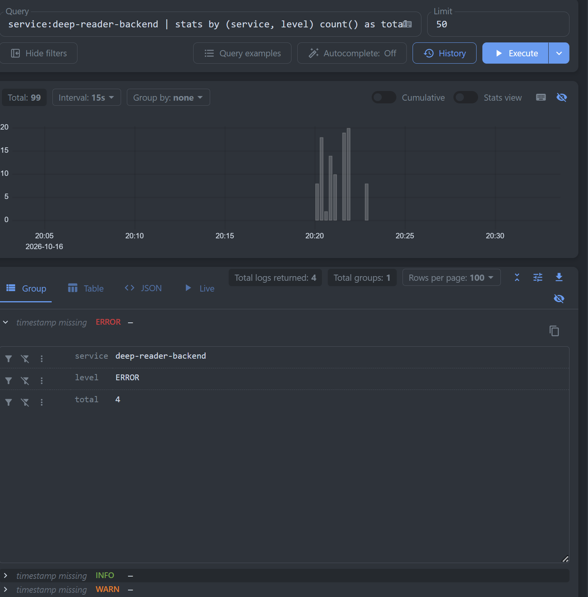
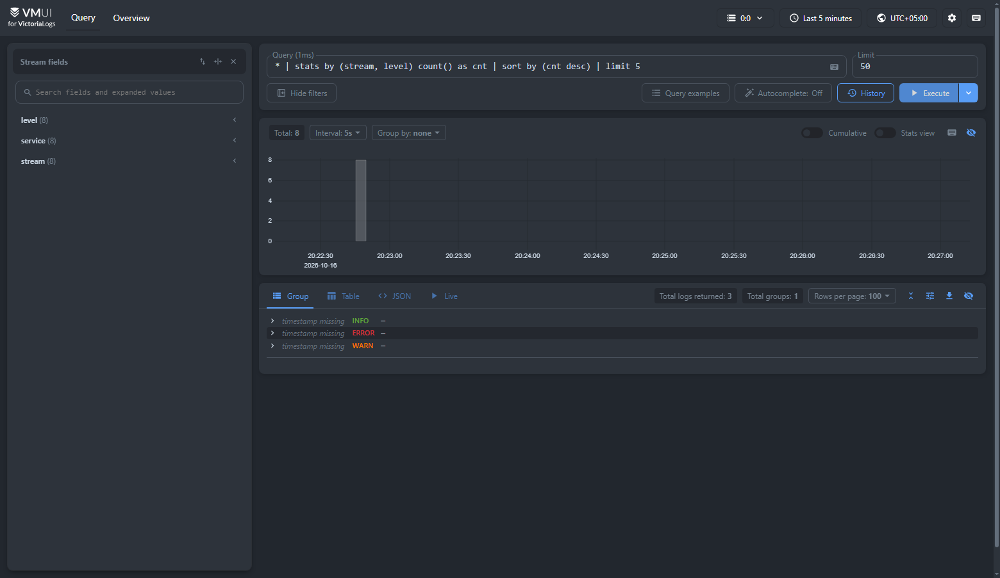
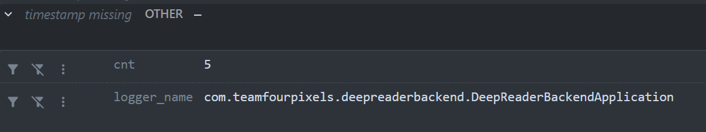
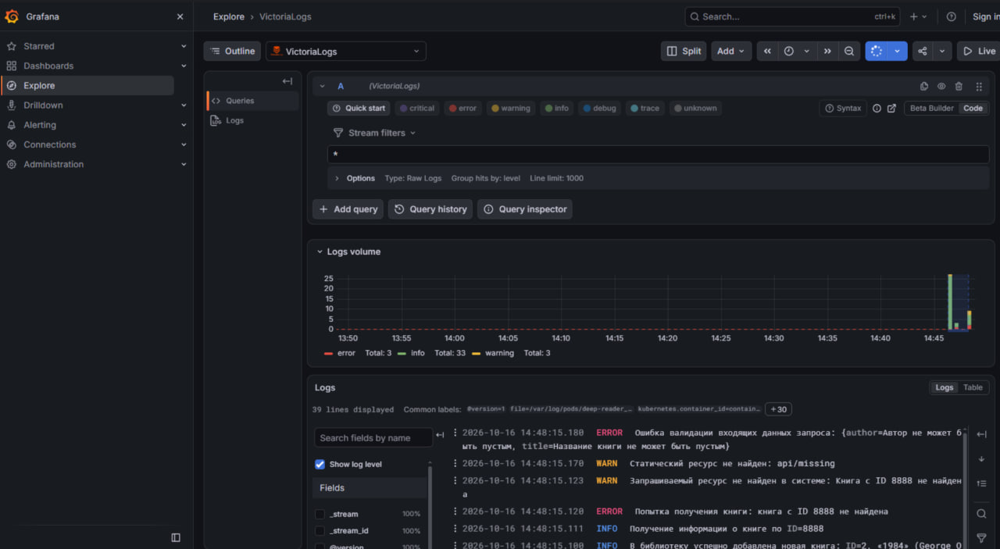
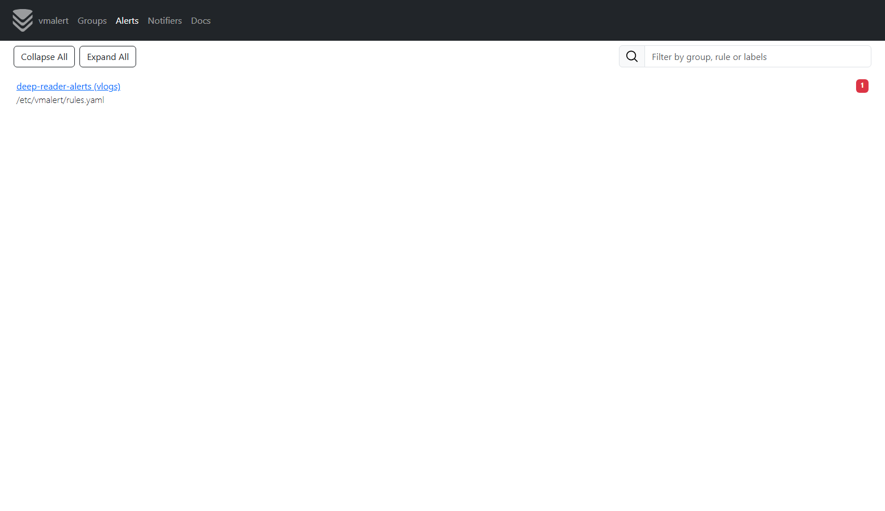

# Deep Reader

# I. Описание проекта

### 1. Доменная область приложения
**Deep Reader** — веб-приложение для осознанного чтения классической и современной прозы в оригинале с контекстными аннотациями, культурологическими комментариями и литературоведческими сносками. 

Приложение решает проблему сложного чтения неадаптированных текстов: читатель может выделять фрагменты, просматривать привязанные к тексту исторические и лингвистические комментарии, добавлять собственные заметки и структурировать аналитический материал по книгам и главам.

### 2. Стек реализации
- **Бэкенд:** Java 25, **Spring Boot 4.1.1** 
- **СУБД:** **PostgreSQL 16** 
- **Миграции БД:** **Liquibase**
- **Пул соединений:** HikariCP с гибкой настройкой через переменные окружения
- **Фронтенд:** Встроенный Single Page Application (SPA) на чистом **HTML5, Modern CSS3 (Grid/Flexbox) и JavaScript (Vanilla ES6+)**, раздаваемый Spring Boot из каталога `static/`.
- **Инфраструктура:** Docker, Minikube, Kubernetes, Victoria Logs, Vector Agent, Grafana, vmalert.

### 3. Основные сущности доменной области
В приложении выделены три ключевые реляционные сущности:

1. **`Book` (Книга):**
   - Поля: `id` (Long, PK), `title` (String, не пустой), `author` (String, не пустой), `description` (Text), `language` (String), `coverUrl` (String), `createdAt` (Timestamp), `updatedAt` (Timestamp).
   - Связи: отношение `@OneToMany` с главами (`Chapter`) и аннотациями (`Annotation`) с каскадным удалением.
2. **`Chapter` (Глава / Часть книги):**
   - Поля: `id` (Long, PK), `chapterNumber` (Integer), `title` (String), `content` (Text — полный текст произведения), `createdAt` (Timestamp).
   - Связи: отношение `@ManyToOne` к родительской книге `Book`.
3. **`Annotation` (Аннотация / Литературоведческая сноска):**
   - Поля: `id` (Long, PK), `selectedText` (Text — фрагмент цитаты), `note` (Text — комментарий/сноска), `type` (Enum `AnnotationType`: `LITERARY_ALLUSION`, `HISTORICAL_CONTEXT`, `LINGUISTIC_NOTE`, `THEMATIC_ANALYSIS`, `CULTURAL_REFERENCE`), `startOffset` (Integer), `endOffset` (Integer), `createdAt` (Timestamp).
   - Связи: отношение `@ManyToOne` к книге `Book` и опционально к главе `Chapter`.

### 4. Реализация CRUD-операций (REST API)
В приложении реализован полный набор RESTful CRUD-операций по спецификации HTTP/1.1 с возвратом кодов состояний (200, 201, 204, 400, 404, 500) и валидацией DTO:

- **Книги (`/api/books`):**
  - `GET /api/books` — получение списка всех книг с подсчётом числа глав и аннотаций.
  - `GET /api/books/{id}` — получение детальной информации о книге.
  - `POST /api/books` — создание новой книги (`Create Book`).
  - `PUT /api/books/{id}` — полное обновление метаданных книги (`Update Book`).
  - `DELETE /api/books/{id}` — каскадное удаление книги и всех зависимых данных (`Delete Book`).
- **Главы (`/api/books/{bookId}/chapters`, `/api/chapters/{id}`):**
  - `GET /api/books/{bookId}/chapters` — список глав книги.
  - `GET /api/chapters/{id}` — получение текста конкретной главы.
  - `POST /api/books/{bookId}/chapters` — добавление новой главы.
  - `PUT /api/chapters/{id}` — редактирование текста и заголовка главы.
  - `DELETE /api/chapters/{id}` — удаление главы.
- **Аннотации и сноски (`/api/books/{bookId}/annotations`, `/api/annotations/{id}`):**
  - `GET /api/books/{bookId}/annotations` — получение всех сносок к книге.
  - `POST /api/books/{bookId}/annotations` — создание сноски к тексту.
  - `PUT /api/annotations/{id}` — редактирование комментария.
  - `DELETE /api/annotations/{id}` — удаление сноски.
- **Системные эндпоинты (`/api/health`, `/api/stats`):**
  - `GET /api/health` — проверка состояния приложения и подключения к БД для проб Kubernetes.
  - `GET /api/stats` — общая аналитика базы (число книг, глав, аннотаций).

---

# II. Домашнее задание №1

Приложение **Deep Reader** спроектировано и доработано в строгом соответствии с 12 факторами создания облачных приложений:

| Фактор | Название | Реализация в Deep Reader и техническая аргументация |
|---|---|---|
| **I** | **Кодовая база (Codebase)** | Единый Git-репозиторий отслеживает всю кодовую базу приложения (`master`). Из одного и того же репозитория собирается единый артефакт (JAR / Docker-образ), который затем развёртывается в различные среды (локально, Docker Compose, Minikube). |
| **II** | **Зависимости (Dependencies)** | Все внешние зависимости приложения явно и изолированно задекларированы в `pom.xml` (Maven Wrapper `mvnw`). Сборка запускается через стандартизированный контейнер без неявного присутствия общесистемных пакетов на хосте. |
| **III** | **Конфигурация (Config)** | Конфигурация строго отделена от кода. Все изменяемые между окружениями параметры вынесены в переменные окружения (`SPRING_DATASOURCE_URL`, `SPRING_DATASOURCE_USERNAME`, `SPRING_DATASOURCE_PASSWORD`, `PORT`, `LOG_LEVEL`, `DB_POOL_MAX`). Локально поддерживается загрузка `.env` через Spring Config Import, а в Kubernetes — через `ConfigMap` и `Secret`. |
| **IV** | **Сторонние службы (Backing services)** | База данных PostgreSQL трактуется как подключаемый ресурс (attached resource). Бэкенд взаимодействует с БД по единому сетевому протоколу через URL подключения. Локальная база, контейнер Docker или облачная управляемая БД подключаются простой сменой переменной окружения без изменения единой строчки кода. |
| **V** | **Сборка, релиз, выполнение (Build, release, run)** | Строгое разделение стадий жизненного цикла: стадия сборки компилирует код и пакует JAR (`mvn clean package`), стадия релиза связывает неизменяемый Docker-образ с версией конфигурации (ConfigMap/Secret в Kubernetes), а стадия выполнения запускает контейнер в кластере. |
| **VI** | **Процессы (Processes)** | Приложение является полностью **Stateless (без сохранения состояния в памяти процесса)**. Любые пользовательские данные, аннотации и книги сохраняются исключительно в постоянное внешнее хранилище (PostgreSQL). Потеря или перезапуск процесса не приводит к потере данных. |
| **VII** | **Привязка портов (Port binding)** | Приложение является полностью самодостаточным сервисом (self-contained) и предоставляет свои функции через привязку к TCP-порту. Внутрь Spring Boot встроен HTTP-веб-сервер Apache Tomcat. Порт биндится через переменную `${PORT:8080}`. |
| **VIII** | **Параллелизм (Concurrency)** | Масштабирование достигается за счёт размножения процессов (подов). Поскольку процессы stateless, увеличение нагрузки парируется горизонтальным масштабированием (`kubectl scale deployment deep-reader-app --replicas=N`). Сетевые сервисы Kubernetes распределяют трафик между репликами. |
| **IX** | **Утилизируемость (Disposability)** | Процессы спроектированы для быстрого запуска и штатного завершения работы (**Graceful Shutdown**). В `application.yaml` включена настройка `server.shutdown: graceful` и таймаут остановки фаз жизненного цикла `timeout-per-shutdown-phase: 20s`, что даёт завершить активные HTTP-запросы перед остановкой пода. |
| **X** | **Паритет окружений (Dev/prod parity)** | Разрыв между разработкой и продакшеном минимизирован. Везде используется одна и та же СУБД (PostgreSQL 16) и одинаковые контейнеры. Исключены ситуации «в dev работает на H2/SQLite, а в prod ломается на Postgres». |
| **XI** | **Журналирование (Logs)** | Приложение не заботится о файлах логов и маршрутизации сообщений. Логи трактуются как непрерывный поток событий и выводятся напрямую в стандартный вывод `stdout` в формате **JSON** (кастомный `CustomJsonLayout` для Logback с поддержкой MDC `trace_id`, `span_id`, вложенных структур `error` и `context` через `TraceContextFilter`). Маршрутизацию и агрегацию осуществляет инфраструктурный агент (Vector DaemonSet). |
| **XII** | **Процессы администрирования (Admin processes)** | Задачи администрирования и миграции схемы базы данных автоматизированы через **Liquibase** (`db.changelog-master.yaml`). Первичная инициализация демо-данных выполняется сервисом `DataInitializerService` в рамках единого релиза. |

---

# III. Домашнее задание №2

### 1. Архитектура и контейнеризация
- Написан оптимизированный многоэтапный `Dockerfile` для упаковки Spring Boot приложения в минималистичный образ на базе OpenJDK.
- Образ приложения собирается и загружается непосредственно в окружение Minikube:
  ```bash
  docker build -t deep-reader-app:latest .
  minikube image load deep-reader-app:latest
  ```

### 2. Использованные абстракции Kubernetes

1. **`Namespace` (`00-namespace.yaml`):**
   - Выделенное логическое пространство имён **`deep-reader`** изолирует компоненты приложения от системных сервисов пространства `default`.
2. **`Pod` (Поды):**
   - Наименьшие исполняемые единицы Kubernetes. В кластере разворачиваются поды бэкенда (`deep-reader-app`) и СУБД (`deep-reader-db`).
3. **`Deployment` (`04-postgres-deployment.yaml`, `06-app-deployment.yaml`):**
   - **`deep-reader-app`**: декларативно управляет подами бэкенда. Настроена стратегия `RollingUpdate`, политика `imagePullPolicy: Never` (использование локально загруженного образа), ресурсные лимиты (CPU/Memory) и пробы готовности.
   - **`deep-reader-db`**: управляет подом PostgreSQL. Применена надёжная стратегия `strategy: type: Recreate` во избежание конфликта одновременного монтирования блочного тома RWO.
4. **`Service` (`05-postgres-service.yaml`, `07-app-service.yaml`):**
   - **`deep-reader-app` (тип `NodePort`, порт 30080):** открывает доступ к веб-интерфейсу и REST API с хостовой машины (`http://<minikube-ip>:30080` или через port-forward).
   - **`deep-reader-db` (тип `ClusterIP`, порт 5432):** предоставляет внутренний статичный адрес и DNS-имя `deep-reader-db` для доступа к СУБД только внутри кластера.
5. **`ConfigMap` (`01-configmap.yaml`):**
   - Хранит несекретные параметры: `SPRING_DATASOURCE_URL`, `DB_NAME`, `DB_HOST`, `DB_PORT`, `PORT`, `LOG_LEVEL`.
6. **`Secret` (`02-secret.yaml`):**
   - Изолированно сохраняет конфиденциальные пароли (`POSTGRES_PASSWORD`, `SPRING_DATASOURCE_PASSWORD`).
7. **`PersistentVolumeClaim` (`03-postgres-pvc.yaml`):**
   - Том на 1Gi с режимом доступа `ReadWriteOnce` (RWO), сохраняющий каталог `/var/lib/postgresql/data` при любых рестартах подов БД.
8. **`Kustomization` (`kustomization.yaml`):**
   - Объединяет все манифесты для воспроизводимого деплоя одной командой: `kubectl apply -k k8s/`.

### 3. Взаимодействие сервисов между собой



- **Сетевой рендеринг CoreDNS:** приложение подключается к базе по DNS-имени `jdbc:postgresql://deep-reader-db:5432/deep_reader`. Встроенный DNS Kubernetes преобразует имя сервиса в виртуальный ClusterIP.
- **HTTP-пробы готовности:** для `deep-reader-app` настроены пробы `readinessProbe` и `livenessProbe` по протоколу HTTP на эндпоинт `/api/health`, подтверждающий статус инициализации контекста и доступность БД.

### 4. Масштабирование и скринкаст
- Горизонтальное масштабирование приложения до 2–3 реплик проверялось командой:
  ```bash
  kubectl scale deployment deep-reader-app --replicas=3 -n deep-reader
  ```
- В корне проекта приложены видеофайлы с полной демонстрацией процесса (`screencast.mp4`, `deep-reader-k8s.mp4`), включающие применение манифестов, просмотр запущенных подов, масштабирование реплик и клики в работающем UI приложения.

---

# IV. Домашнее задание №3

### 1. Архитектура логирования
В кластер развёрнута масштабируемая система сбора, хранения и анализа логов:



### 2. Форматирование логов приложения в JSON (stdout)
Для формирования структурированных логов строго в заданном JSON-формате реализованы следующие компоненты:
- **`CustomJsonLayout` (`com.teamfourpixels.deepreaderbackend.config.CustomJsonLayout`):** кастомный высокопроизводительный Logback Layout без внешних библиотечных зависимостей, сериализующий события логирования в целевую JSON-структуру с полями `timestamp`, `level`, `service`, `trace_id`, `span_id`, `thread`, `message`, а также объектами `error` (`type`, `message`, `stack_trace`) и `context` (`request_path`, `http_method`).
- **`TraceContextFilter` (`com.teamfourpixels.deepreaderbackend.config.TraceContextFilter`):** сервлетный фильтр (`OncePerRequestFilter`), генерирующий 32-символьный hex `trace_id` и 16-символьный hex `span_id` (либо пробрасывающий их из входящих заголовков `X-Trace-Id` / `X-B3-TraceId`), а также сохраняющий `request_path` и `http_method` в контекст SLF4J MDC.
- **`logback-spring.xml`:** связывает консольный `ConsoleAppender` с `CustomJsonLayout`.

Каждая запись лога выводится в `stdout` как самостоятельный JSON-документ в строгом соответствии с целевой схемой:
```json
{
  "timestamp": "2026-10-16T15:04:05.123Z",
  "level": "ERROR",
  "service": "deep-reader-backend",
  "trace_id": "4bf92f3577b34da6a3ce929d0e0e4736",
  "span_id": "00f067aa0ba902b7",
  "thread": "http-nio-8080-exec-2",
  "message": "Failed to create book: validation failed",
  "error": {
    "type": "MethodArgumentNotValidException",
    "message": "Validation failed for argument [0] in public BookResponse...",
    "stack_trace": "org.springframework.web.bind.MethodArgumentNotValidException: Validation failed...\n\tat org.springframework.web..."
  },
  "context": {
    "request_path": "/api/books",
    "http_method": "POST"
  }
}
```

### 3. Обоснование выбора способа доставки логов
Для доставки логов выбран **Vector в режиме DaemonSet** (`k8s/09-vector.yaml`):
1. **Соответствие 12 факторам:** Приложение не содержит сетевых библиотек отправки логов, не блокирует запросы клиентов и пишет только в `stdout`.
2. **Преимущество DaemonSet перед Sidecar:** Запускается ровно один легковесный агент на узел Minikube, собирающий логи всех контейнеров хоста. Сайдкар рядом с каждым подом кратно умножал бы расход RAM и CPU при масштабировании реплик.
3. **Преимущество Vector (Rust) перед Fluent Bit:** Высочайшая скорость, безопасность памяти, мощный движок трансформаций VRL и официальная поддержка разработчиками VictoriaMetrics.
4. **Трансформация VRL:**
   ```yaml
   parsed, err = parse_json(.message)
   if err == null {
     del(.message)
     . = merge!(., parsed)
   }
   ```
   Скрипт распаковывает JSON-сообщение в атрибуты первого уровня, позволяя Victoria Logs индексировать `level`, `service`, `logger_name` напрямую.

---

### 4. Четыре LogsQL-запроса в веб-интерфейсе vmui

Интерфейс доступен по адресу `http://localhost:9428/select/vmui/` через команду:
```bash
kubectl port-forward -n deep-reader service/victoria-logs 9428:9428
```

#### Запрос (а): Сырые записи за последние N минут
- **LogsQL-запрос:**
  ```logsql
  _time:30m
  ```
- **Скриншот интерфейса vmui:**

  

- Возвращает все неотфильтрованные строки логов за последние 30 минут в обратном хронологическом порядке с отображением распарсенных полей (`_time`, `_msg`, `stream`, `level`, `service`).

---

#### Запрос (б): Фильтр по конкретному полю (`level:ERROR`)
- **LogsQL-запрос:**
  ```logsql
  level:ERROR
  ```
- **Скриншот интерфейса vmui:**

  

- Фильтрует структурированный поток и выводит исключительно записи с ошибками валидации (`GlobalExceptionHandler`), возникшими при отправке некорректных DTO.

---

#### Запрос (в): Stats-запрос с группировкой по уровню логирования и сервису
- **LogsQL-запрос:**
  ```logsql
  * | stats by (service, level) count() as total
  ```
- **Скриншот интерфейса vmui:**

  

- Выполняет аналитическую группировку записей по сервису и уровню логирования, подсчитывая общее число событий каждого уровня (`INFO`, `WARN`, `ERROR`).

---

#### Запрос (г): Агрегирующий запрос (Top логгеров по числу сообщений)
- **LogsQL-запрос:**
  ```logsql
  * | stats by (logger_name) count() as cnt | sort by (cnt desc) | limit 5
  ```
- **Скриншот интерфейса vmui:**

  
- 

- Анализирует частоту вызовов логгеров и выдаёт Топ-5 наиболее «шумных» Java-классов в системе, упорядочивая результат по убыванию.

---

### 5. Бонусные задания

В проекте реализованы **оба** бонусных задания:

#### 5.1. Подключение официального плагина Victoria Logs в Grafana
Развёрнут манифест `k8s/10-grafana.yaml` с плагином `victoriametrics-logs-datasource` и авто-настройкой источника данных (`url: http://victoria-logs.deep-reader.svc.cluster.local:9428`):



#### 5.2. Настройка подсистемы алертинга vmalert на основе LogsQL
Развёрнут сервис **vmalert**  с правилом вычисления над эндпоинтом `/select/logsql/stats_query` Victoria Logs:
```yaml
groups:
  - name: deep-reader-alerts
    type: vlogs
    interval: 10s
    rules:
      - alert: ErrorLogsTriggered
        expr: '_time:24h AND level:ERROR | stats by (service) count() errors | filter errors:>0'
        for: 0s
        labels:
          severity: critical
        annotations:
          summary: "В сервисе {{ $labels.service }} обнаружены ошибки level:ERROR"
          description: "Зафиксировано ошибок: {{ $value }}"
```
При наличии в логах ошибок правило автоматически переходит в статус **`FIRING`** и отображается в интерфейсе `http://localhost:8880/vmalert/alerts`:



---

# Раздел V. Структура репозитория и манифестов

Все манифесты для развёртывания приложения и инфраструктуры логирования сохранены в директории `k8s/`:

```
k8s/
├── 00-namespace.yaml           # Выделенный namespace deep-reader
├── 01-configmap.yaml           # Конфигурация параметров бэкенда и БД
├── 02-secret.yaml              # Секреты (пароли к СУБД)
├── 03-postgres-pvc.yaml        # Постоянный том PostgreSQL (RWO 1Gi)
├── 04-postgres-deployment.yaml # Развёртывание PostgreSQL 16 (strategy: Recreate)
├── 05-postgres-service.yaml    # Внутренний сервис БД (ClusterIP: 5432)
├── 06-app-deployment.yaml      # Развёртывание бэкенда (imagePullPolicy: Never, httpGet /api/health)
├── 07-app-service.yaml         # Внешний сервис приложения (NodePort: 30080)
├── 08-victoria-logs.yaml       # Deployment, Service, PVC для Victoria Logs (Single-node, порт 9428)
├── 09-vector.yaml              # DaemonSet, RBAC и VRL-конфиг агента сбора логов Vector
├── 10-grafana.yaml             # Grafana с плагином victoriametrics-logs-datasource
├── 11-vmalert.yaml             # Сервис алертинга vmalert с правилом на базе LogsQL
└── kustomization.yaml          # Единая точка декларативной сборки (namespace: deep-reader)
```

---

# Раздел VI. Инструкция по локальному воспроизведению

1. **Запуск Minikube:**
   ```bash
   minikube start --driver=docker
   ```

2. **Сборка и загрузка образа приложения:**
   ```bash
   docker build -t deep-reader-app:latest .
   minikube image load deep-reader-app:latest
   ```

3. **Развёртывание всего стека одной командой через Kustomize:**
   ```bash
   kubectl apply -k k8s/
   ```

4. **Проверка готовности подов (`kubectl get pods -n deep-reader`):**
   Все 6 подов должны перейти в статус `1/1 Running`:
   - `deep-reader-app`
   - `deep-reader-db`
   - `vector`
   - `victoria-logs`
   - `grafana`
   - `vmalert`

5. **Проброс портов для доступа к веб-интерфейсам:**
   ```bash
   kubectl port-forward -n deep-reader service/deep-reader-app 8080:8080

   kubectl port-forward -n deep-reader service/victoria-logs 9428:9428

   kubectl port-forward -n deep-reader service/grafana 3000:3000

   kubectl port-forward -n deep-reader service/vmalert 8880:8880
   ```
